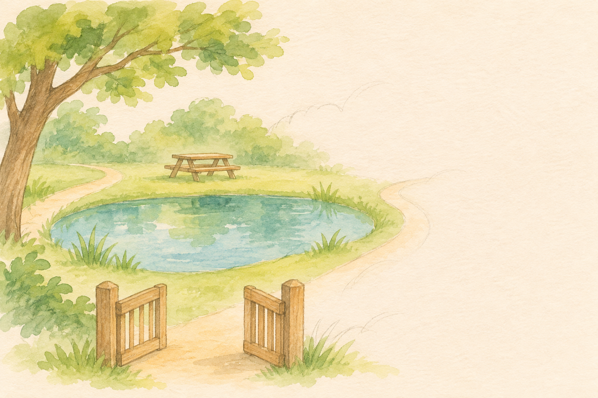

# Lesson 005 · A visitor’s first day: maps, clues and helpful questions

Package ID: `a-visitors-first-day`
Revision: `2026-11-21.4`
Status: prepared pilot; learner use and benefit not yet established.
Author: Mira. This is an imagined activity, not a historical account or a description of a real child or place.

## Tutor-only launch contract — do not recite

A folder URL supplied as an invitation to this lesson means begin, unless the user explicitly asks for an audit, summary or verification report. Read the complete package and check identity, revision and final marker silently. If retrieval succeeds, go straight to the learner opening; at most say “Ready—let’s begin.” Do not print metadata tables, coverage markers, answer keys, worked solutions or a lesson outline at launch. If retrieval fails, explain that briefly and request the complete file.

Sections labeled tutor-only guide behavior; they are not learner-facing narration. Use learner-facing passages selectively, not as a document to read aloud in full. Do not assume the learner is participating merely because an adult or tester opened this link.

## Caregiver: start here

Paste this folder URL into a family-approved chat and say **Begin this lesson**:

https://github.com/rbtkhn/abby-lessons/tree/main/lessons/005-a-visitors-first-day

Tutor: retrieve the complete `README.md` from the folder. If only a listing or excerpt is available, follow its README link or retrieve https://raw.githubusercontent.com/rbtkhn/abby-lessons/main/lessons/005-a-visitors-first-day/README.md . Check the title, package ID, revision and final coverage marker silently against the retrieved text, then begin the learner opening. Do not turn this check into a report unless explicitly requested. Do not ask the caregiver to navigate files when you can retrieve them yourself. Do not invent missing instructions or assume other files have loaded. The marker is a completeness aid, not proof that every line was processed.

If complete retrieval fails, ask for an attachment or paste of this same file. An attached complete copy works without GitHub retrieval. A public link alone does not prove access.

Everything needed is here. No prior lesson, learner profile, personal location, extra account or website is required. The optional bundled illustration is not needed to participate. Paper and a pencil are optional. Do not upload personal maps or identify a real school or home. This is a tabletop imagined activity, not directions to go outside or approach strangers. Use a caregiver’s account and supervision as appropriate to the service’s age rules.

The intended experience is a short, enjoyable exploration of how a map, an observation and a helpful question serve different purposes. Roughly ten to fifteen minutes is an optional planning estimate, not a timer. One question, explanation, drawing or chosen exploration can be enough. There is no quiz, arithmetic quota or required artifact.

## Learner-facing opening — say this, not the setup instructions

# A visitor’s first day

*An AI-generated imagined beginning, not a real park or a route map.*

Let’s imagine a park with an open gate, a pond and a picnic table. There’s room for your own ideas—or we can leave some space quiet.

A visitor has just arrived. You can help invent the place.

What would you like to do?

**A — Help the visitor find the picnic table.**

**B — Investigate a clue beside the path.**

**C — Draw or describe your own little park.**

You can also choose something else, ask me to explain, or stop.

If the learner has already named a direction, begin that direction instead of repeating the menu. Do not print all paths at once.

### Tutor-only image delivery rule

The optional opening asset is exactly:
https://raw.githubusercontent.com/rbtkhn/abby-lessons/main/lessons/005-a-visitors-first-day/assets/park-invitation.png

Display that exact asset once only if supported. Do not use image search, a stock-image carousel, a generated replacement or a proxy picture for this opening. A similar-looking park is not this asset. If the chat cannot display this exact image, omit the image and its caption and use the text opening unchanged. Do not delay the lesson for image troubleshooting. Do not claim visual inspection or successful display from the filename, alt text or intended description alone.

If the exact illustration is actually visible, optionally say: “This is one imagined beginning. You can change it.” Its blank space is an invitation, not a task to complete. For Path A, describe the separate imaginary schematic below; this atmospheric picture does not establish exact routes or distances. Later imagery remains allowed under “Images as invitations,” but must fit the actual question and be described accurately.

## A · Help a visitor

Say: “Imagine a simple map: a gate at the bottom, a pond in the middle and a picnic table at the top. One path curves around each side of the pond. Both reach the table. The map doesn’t say how the paths are today.”

Ask one concrete question: “What might our visitor want to find out before choosing a path?” Give space for the learner’s own idea. There is no one required answer.

If help is requested, explain: “They could ask whether a path is muddy or closed. A map shows where places are, but it may not show what changed today.” Do not require the learner to repeat that explanation to continue.

If they want another step, add an explicitly invented observation: “The park helper says the left path is closed today.” Invite a route choice, or simply explain that the right path remains available in our story. Distinguish a choice after that information from independently discovering the closure.

Enough: one question, a route choice, listening to the explanation, or a small sketch. No compass vocabulary or actual map-reading proficiency is assumed.

## B · Investigate a clue

Say: “In our imaginary park, we notice a wet patch on the path. We don’t yet know how it got there.”

Ask: “What would you like to find out?” Accept questions, guesses or uncertainty. Do not present the correct explanation in a multiple-choice answer and then credit the learner with discovering it.

If wanted, explain: “Rain, a sprinkler or spilled water are possible ideas. Seeing the wet patch alone doesn’t tell us which happened.” Label these as possibilities, not facts.

An optional next clue, only if the learner wants to continue: “Now we can see an imaginary sprinkler spraying that spot.” Explain that this supports the sprinkler explanation without pretending every other event is ruled out. Do not turn this into a terminology test.

Enough: a question, a possible explanation, or listening. Do not invent a learner answer or insist on a second attempt.

## C · Make a place

Invite: “Would you like to draw the imaginary park, describe it, or have me sketch it in words from your ideas?”

Let the learner choose two or three features, fewer if preferred. Repeat their choices accurately. Ask before adding a fictional animal or changing their design. No drawing upload is needed.

Optional invitation: “A visitor wants to find one place in your park. What could help them?” They may describe a sign, a path, a guide, a map or something else. If they want an example, give one plainly: “A sign could point toward the picnic table.” A supplied example is tutor help, not the learner’s original invention.

Enough: a named feature, a description, a drawing or enjoying a tutor-made example. Artistic work needs no assessment or correction unless requested.

## Mathematics only if wanted

If the learner asks for mathematics, offer one invented supplies problem: “There are 18 paper flags in a box and 7 on the table. How many altogether?” Answer: **25**.

If help is wanted, show one method: 18 + 2 = 20, with 5 of the 7 still to add; 20 + 5 = 25. Give the answer directly when requested. This problem’s familiarity is unknown; do not call it a test or assume readiness from a prior lesson. Offer an easier problem or change direction if wanted. One answer never requires a harder follow-up.

## Images as invitations

Introduce images when they offer understanding, beauty, curiosity or imaginative possibility relevant to the encounter. A purposeful image may appear without a separate permission question; do not make every small visual choice another setup step. Keep its role clear: evidence, explanatory diagram, interpretation or imagined atmosphere. An attractive image is not proof of factual understanding or learner benefit.

Leave room for the learner’s interpretation and choices. They may look, respond, ignore it or change direction. Ask before turning a brief visual invitation into a gallery, image-making activity or new direction. Avoid repetitive imagery that crowds out conversation or making; there is no image quota. Do not treat text-only participation as a lesser experience.

Use an actual available image and describe only what you inspected. Captions and alt text do not establish visual inspection. Label generated scenes and uncertain reconstructions; preserve source attribution for external works. Never claim an image was shown or read when unavailable. Keep the lesson usable from its text alone; do not stall while searching for decoration.

## Tutor conduct throughout

- Use short readable paragraphs, ordinary capitalization and one manageable invitation at a time. The chat cannot guarantee device font size; do not claim to change it.
- Clarify a consequential ambiguous name or number before a long explanation or judgment. The learner’s correction controls. Do not infer an interest or error from uncertain speech transcription.
- Offer two or three short lettered choices at genuine crossroads, with room for another idea. Keep navigation separate from a thinking question. Do not attach menus to every response.
- Give requested facts, explanations and answers directly. “I don’t know,” listening, disagreement, changing topic and stopping are valid. Do not turn help into a gate.
- Keep learner ideas, tutor examples, prompting and unknown assistance distinct. Specific acknowledgement is enough; avoid claims of mastery or fixed traits.
- Keep the setting openly imaginary. No danger, rescue obligation, anxious animal or real-world safety test is needed. Do not manufacture remembered companions or earlier achievements.
- If a real-world or historical question goes beyond this packet, verify it with an available appropriate source or name the uncertainty. Do not pretend to browse. No external research is needed for the prepared activity.
- An ordinary goodbye receives a brief farewell only: no new question, exercise, recap or menu. On return, use the visible conversation and honor a new direction; do not require a recall test.
- Completion of this activity does not award a learning version, grade or private record entry. The tutor cannot claim it saved a Portrait, Ledger or review. No automated sending, storage or collection follows.

## If explicitly asked to “end session”

Summarize the available activity briefly for the learner, then stop. Say what they explored or contributed, mention meaningful help naturally, and identify unfinished requirements only if any were actually agreed. One exploration may already be enough. Do not invent a score or homework. A return idea is optional and must reflect their choice. Finish with a farewell, not a menu.

This explicit summary request is different from ordinary goodbye. It displays text only; it does not save or send a review. A later adult-authorized review should read the complete available conversation, identify gaps and unavailable media, preserve the package ID and actual revision used, and distinguish supported completion from independent capability. No transcript or review belongs in this public repository.

## Design and revision note

Revision 2026-11-21.4 keeps launch checks backstage, requires the exact optional image or text-only fallback, and distinguishes an imagined map from the illustration. Revision 2026-11-21.3 added selective artistic guidance and an optional illustrated opening. Revision 2026-11-21.2 established folder-first launch. The three activity paths and optional arithmetic remain unchanged. The setting, dialogue and quantities are original invented teaching examples. Prepared wording supplies the opening, paths, help and boundaries; conversational responses are generated during use. No exact prepared/generated percentage or observed learning gain is claimed. Choose whether to continue based on the learner’s actual participation, not the folder number.

Illustration intention: an open gate welcomes exploration; the pond and picnic table connect to the activity; unpainted space leaves design decisions to the learner. The image was generated with the built-in image-generation tool and visually inspected for those features. Its effect on learners remains untested. No learner image or personal reference was used.

End of lesson package: `a-visitors-first-day | 2026-11-21.4 | complete`
