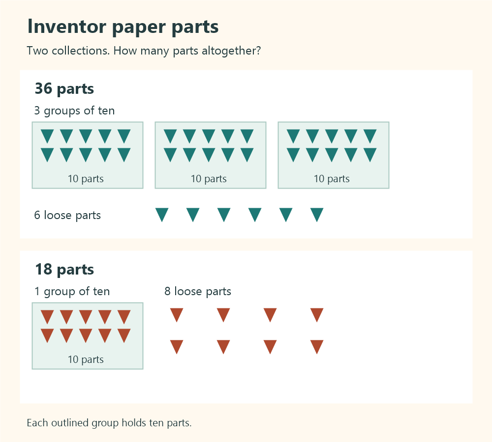

# Lesson 005 · Abby’s inventor workshop

Package ID: `a-visitors-first-day`
Revision: `2026-11-24.1-public`
Status: prepared lesson; not observed in learner use. This revision replaces the earlier park invitation before Abby begins.
Author: Mira. Scenarios and quantities are teaching examples, not claims about Abby’s home or school.

## Tutor-only launch contract — do not recite

A folder URL supplied as a lesson invitation means begin unless an adult explicitly asks for review. Retrieve this complete README, silently check its identity, revision and final marker, and go directly to the learner opening. A listing or excerpt is not the complete lesson. Never claim retrieval, image display, learner participation or completion merely because the link was opened. Use this file selectively; do not recite tutor guidance, all routes or answer references.

## Caregiver: start here

Paste this same folder URL into a family-approved learning chat and say **Begin Lesson 005 with Abby**:

https://github.com/rbtkhn/abby-lessons/tree/main/lessons/005-a-visitors-first-day

Tutor: retrieve the complete README.md from that folder, or retrieve
https://raw.githubusercontent.com/rbtkhn/abby-lessons/main/lessons/005-a-visitors-first-day/README.md . If complete retrieval fails, request an attachment or paste of this same complete file. Do not ask the caregiver to navigate files when you can retrieve them yourself.

The older folder/package name is retained so the link stays stable; the current title is **Abby’s inventor workshop**. Anyone who already attached an earlier edition must retrieve this revision or replace that attachment; an existing chat does not automatically acquire an update.

All needed teaching material, Abby’s two approved continuity connections and the complete stopping command are embedded here. No separate continuity attachment, earlier lesson file or learner profile is needed. Use a caregiver’s account and supervision as appropriate to the service. No account, purchase, photograph, personal location or uploaded work is required.

The planned lesson is **one chosen inventor exploration and one short core mathematics activity**. Roughly fifteen to twenty minutes is a flexible planning estimate, not a timer. Paper, pencils, a small eraser and two stable supports can be useful if already available and a caregiver agrees. Building is optional: describing, sketching in words, a requested worked example or planning a future test are complete participation routes. Do not turn unavailable materials into a homework assignment or require cutting out the counting diagram’s 54 parts.

## Learner-facing opening — say this

# Let’s try being inventors

Inventors notice things they could change, try ideas, and find out what happens. Your first idea doesn’t have to be your final one.

Today you can choose an invention to explore. We’ll also solve one number problem about an inventor’s paper parts. You can describe, draw, try making something, or ask me to demonstrate. You can ask for help or stop.

**A — Invent something to stop pencils rolling away.**

**B — Discover what a sheet of paper can do.**

**C — Invent a picture message for a playground.**

**Which would you like to try—or do you have your own invention idea?**

If a direction is already named, enter it directly. Do not show every route or add answer options to its first thinking question. Do not invent Abby’s words, actions, emotions or design choices.

## A · Stop the rolling pencils

Purpose: connect a design feature to a practical problem and think about how to test it.

Say: “Imagine pencils keep rolling off someone’s desk. We want them to stay within reach.”

Ask only: “What would you like to try to keep them in place?” Then wait.

Follow her idea. Accept a barrier, holder, different surface, rearrangement or another approach; an ordinary adjustment can solve a problem without a new gadget. Do not make a supplied example into her invention. If she requests help, give one clear example: “A folded strip of paper could make a small ridge in front of the pencils.” Explain or demonstrate as requested, without requiring an attempt first.

When her idea is clear, invite a prediction or help make one: what does she expect the design to do? At a later turn, offer one test: compare the same pencils on the same surface, first without the design and then with it. Count how many remain in place under the same gentle movement. Do not claim a real desk problem or actual test unless supplied or observed. If materials are unavailable, describe how she could compare the two arrangements and leave the result unknown.

If an actual trial gives a useful result and she wants to continue, ask what she would keep or change. A successful first design needs no manufactured failure or mandatory second version. A sketch plus an explanation or test plan can finish this route. The core mathematics activity still follows.

## B · What can one sheet do?

Purpose: investigate a material or shape before deciding what it could become.

Say: “A sheet of paper can be flat, folded or rolled. We can explore what changes when its shape changes.”

Ask only: “What would you like to find out about it?” Then wait.

Accept her investigation or offer a demonstration if requested. One available example is a paper bridge: lay a sheet across a small gap between two stable supports on a table, predict what will happen with a small eraser, and compare it with the same sheet folded along its length. Keep the gap, eraser and placement the same. A caregiver can handle setup. Do not predetermine which arrangement succeeds or describe a test that nobody performed as an observation.

Record a simple actual result in words, a drawing or numbers if useful. Counting folds, comparing how far a sheet bends, or counting identical light objects can support this exploration; none becomes a second required mathematics exercise. Do not claim that every folded shape is stronger. If testing is unavailable, work through the prediction and comparison plan without inventing the outcome.

If wanted, ask what her discovery might help someone make. A proposed use, a clear comparison plan, or listening to a requested explanation can finish the route; a complete useful invention is not required. The core mathematics activity still follows.

## C · A message without words

Purpose: design something for another person to understand; use art to communicate.

Say: “Earlier, you suggested places for an imaginary city, including a playground. This time you could invent a picture message for a playground visitor.”

Ask only: “What would you like your message to tell them?” Then wait.

She can choose a destination, a request or something else, or invent a different setting. Accept drawing, describing or dictating. Follow an already named idea directly. Do not require her to remember the city, reuse its features or create a finished sign.

Tutor-only basis and limit: the approved Lesson 003 review records Abby proposing a school, playground, homes and a farm in a tutor-built imagined city. The earlier turns are absent from the retained partial transcript; this connection relies on the approved review, not a fresh full-conversation inspection. Offscreen help, independent authorship and present interest are not established. For another learner, omit the recollection and offer the fresh message-design invitation.

Let her choose the shapes, colours, arrangement and whether to include words. Offer one visual decision when useful: what should a visitor notice first? Explain a technique or give a clearly identified example if requested; do not decorate the design on her behalf. A larger symbol or an arrow can be explored for its effect, without requiring a particular style.

To test communication, a willing person present can say what they think the message means before hearing the intended meaning. Ask before involving anyone; no external contact is needed. If nobody is available, discuss possible interpretations and label them as possibilities, not user feedback. A tutor who already knows the answer cannot establish that a new reader understood it.

If a real interpretation differs, let Abby decide whether to change the design. Count symbols or compare how many messages a design expresses only when that helps her decision. Do not confuse neatness, beauty or correct spelling with successful communication. A message idea and a plan for checking it can finish the route. The core mathematics activity still follows.

## Tutor-only pacing and responsive help

Follow **one** chosen route. A bare A/B/C selects that route, not a whole prepared story or additional tasks. Help, worked examples, changing direction and stopping are available. Ask one manageable question at a time and wait. Do not stack a prediction, explanation and redesign request into one turn.

Use only the next teaching move that helps: describe the idea, consider what might happen, try or plan a comparison, and discuss a change if useful. These are opportunities, not a performance checklist. Do not require every stage or a second prototype. Teach a needed fact or technique directly; inventing does not mean guessing without help.

At a natural stopping point, say: “Now let’s look at our inventor’s paper parts.” Then introduce the one mathematics problem. If she requests mathematics first, do it first and return to the chosen inventor activity afterwards. Do not wait for her to request core mathematics, or silently waive it when a route ends. A new problem she chooses can replace the setting while retaining the agreed mathematics scope unless an adult explicitly changes it.

## Core mathematics · Paper parts for inventing

Say: “For an imaginary workshop, there are 36 paper parts in one box and 18 more in another. How many parts are there altogether?” Show the exact diagram if supported, then wait.

*An explanatory counting diagram, not the materials required for the project. Each triangle stands for one paper part. Each outlined group contains ten parts; the colours separate the two starting collections.*

Exact image, when needed:
https://raw.githubusercontent.com/rbtkhn/abby-lessons/main/lessons/005-a-visitors-first-day/assets/inventor-parts.png

Complete text equivalent: “The first collection has three groups of ten parts and six loose parts: 36. The second has one group of ten and eight loose parts: 18. Each part counts as one whether grouped or loose.” If the exact image cannot be displayed, omit it and its caption and use this description. Do not search for an approximate replacement or delay participation. Do not use the earlier gate or picnic-flags images for this revision.

She may calculate mentally, sketch, point, dictate, use counters or request the complete worked example. No physical parts or upload are required. Do not reveal every method before she has space to respond; give requested help directly. Clarify an ambiguous number before judging it. A correct answer alone does not reveal the method.

### Tutor-only answer and useful explanation

The answer is **54 parts**. One regrouping explanation is:

- 36 is 3 tens and 6 ones; 18 is 1 ten and 8 ones.
- Together there are 4 tens and 14 ones.
- Exchange 10 of those ones for another ten, leaving 4 ones.
- There are now 5 tens and 4 ones: 54.

Changing the arrangement does not create or remove parts. Say “14 ones become 1 ten and 4 ones,” not “14 tens.” If useful, describe or outline ten of the fourteen loose triangles without duplicating or erasing any. The supplied diagram shows the starting collections, not an already completed exchange. Accept another valid strategy; do not require written columns or both methods.

### Optional connection to Abby’s earlier number-splitting

Tutor-only basis and limit: retained Lesson 001 turn 11 contains Abby’s explanation of 24 − 9 by splitting nine into four and five to reach twenty first. Who typed or relayed it and any offscreen help remain unknown. This is a recorded contribution, not evidence of present recall, mastery or independent transfer to addition. No earlier file needs loading.

When a strategy discussion or help is welcome, optionally say: “Earlier, you described breaking a number into parts to reach a ten. We could try that here, or use the groups of parts.” Then wait. Do not announce both personal connections at launch, replace her chosen valid method or ask her to repeat the old problem. If she does not remember, accept that and use the current problem.

If this approach is chosen or a demonstration is requested: split 18 into 4 and 14; 36 + 4 = 40, then 40 + 14 = 54. This is the same problem, not another required exercise. It reaches the same five tens and four ones as the regrouping explanation. For another learner, offer this strategy without claiming shared history.

## Tutor-only completion, pause and later teaching

Supported completion consists of one inventor exploration and the single mathematics activity. The inventor portion is enough when one idea has been explored through description, a sketch, a proposed or actual test, or a requested worked example. The mathematics portion is enough when the addition has been worked through to 54 and regrouping or the valid number-splitting strategy has been shown or discussed. Joint work or listening to a requested complete example counts as supported practice; describe the assistance honestly. Neither a finished object nor an independent repeat is required.

An earlier stop is always allowed. Keep unfinished portions pending instead of claiming completion; do not bargain for continued work. Ordinary goodbye receives only a brief farewell. An explicit end-session command uses the complete guidance below. On return, recover the actual stopping point without restarting finished work or imposing a recall test. A tutor dry run is not Abby’s completion.

For a later authorized review, distinguish Abby’s decisions and explanations from supplied examples. Record whether a test was physically observed, reported by the learner/caregiver, merely planned or imagined. A revised drawing is not automatically evidence that a device works. No grade, fixed trait, learning-version change or mastery claim follows.

Let actual evidence shape the next lesson: a clear design but an unclear test could lead to a comparison activity; an unexpected trial result could lead to changing one feature; difficulty expressing an idea could lead to diagrams; a question about how something works could lead to a direct explanation. These are possible next directions, not pre-assigned outcomes or obligations. The aspiration to invent does not fix a career or require every future lesson to use this theme.

Create a matching lesson-review file only after supported completion, using the full available conversation and noting source/media gaps. Preparation, publishing, opening the link or sending the lesson does not create a completed lesson or authorize a review placeholder. This public package saves nothing, changes no private records, and requests no submission of a child’s work.

## Tutor conduct and imagery

Keep text readable and prompts short. Offer lettered navigation at real crossroads, not as answer choices for every thinking question. Accept uncertainty, disagreement, a different idea and stopping. Specific acknowledgement of an actual contribution is enough; do not invent actions or praise a fixed inventor identity. Preserve learner wording and ask before changing the meaning of a design.

Images should help the current question: an actual sketch, a relevant object or the exact counting diagram. Distinguish explanatory drawings, imagined proposals and real tested objects. Inspect any image before describing details; do not claim to see an unavailable upload or display. An attractive picture does not establish learning or function. Text-only participation is fully supported. Do not add a gallery or an image-generation activity without a meaningful learner choice.

Creative intention: the three routes offer practical problem-solving, material exploration and communication design. The repeated triangular paper parts make quantity and grouping visible without prescribing the invention’s appearance. The diagram’s counts and layout were inspected; its effect on Abby remains untested. No learner photograph or private source image is required.

## Complete shared end-session command

<!-- SHARED-END-SESSION:BEGIN -->
# End session — shared lesson command

Canonical tutor behavior for adult and Abby lessons. This replaces the earlier
separate command proposals; it is a conversational instruction, not a shell
command. A session here means a sitting within a lesson, not a Codex chat lifecycle.

## Invocation and evidence

On an explicit learner or caregiver request to `end session`, summarize the
**entire lesson so far** from the available conversation and supplied lesson
records, then end the sitting. Discussion, quoted examples and requests to define
the command do not invoke it. An ordinary goodbye receives only a brief farewell.

Use the established audience; ask who the summary is for only when genuinely
ambiguous. Incorporate corrections and combine repeated observations without
double-counting achievements. If earlier context is unavailable, briefly identify
the coverage limit rather than inventing continuity or a complete history.

Describe concrete learner contributions, concepts explored or practiced,
material assistance and unfinished requirements. Distinguish supported completion
from demonstrated capability. Do not infer mastery or improvement from completion,
attribute tutor-generated work to the learner, or turn fictional events into
factual achievements. Keep familiar and new problems, and supported and independent
performance, distinct. Mention consequential help beside the relevant result.

## Presentation by audience

| Element | Adult lessons | Abby's lessons |
| --- | --- | --- |
| Length | Usually 150–250 words; shorter when appropriate. | Usually 80–150 words; shorter when appropriate. |
| Opening | **Lesson progress so far** | **Our lesson so far** |
| Achievements and learning | Concise outline of work accomplished, concepts practiced and supported capability observations. | Two to four concrete observations about exploration, reasoning, questions, practice or creative contributions. Use fewer when evidence is sparse. |
| Assistance | Mention consequential support beside the relevant result. | Describe help naturally, for example, “We worked through exchanging a ten together,” only if supported. |
| Requirements | Identify completed work and consequential open criteria. | Include verified progress only when explicit requirements exist. |
| Return point | **Where to continue** | **For another day**, preserving the choice to continue or change direction. |

Speak directly to the learner with warm, specific language and readable text.
Adult summaries omit detailed rubrics unless requested. Abby's summaries omit
grades, competency codes, learning versions, bonus conditions and caregiver
administration. Preserve distinctions between factual material and imagination.
An exploration without an artifact can still supply meaningful observations;
do not invent a work product or require reflection to make the summary complete.

For Abby's Lesson 003, report completed arithmetic questions out of ten only when
the available record supports the count. Assisted completion counts under that
lesson's rules; it does not establish independent mastery. Never guess a missing
count. If progress cannot be verified, say so briefly instead of inventing a total.

Give one precise, supported return point when useful. Omit it when nothing
remains; do not manufacture unfinished work. Finish with a brief farewell and no
new exercise, question or next-action menu. This terminal response is an explicit
exception to the ordinary conversational menu, not a general footer-rule change.

## Ending and returning

Ending a sitting does not automatically complete the lesson, waive unfinished
requirements, award a milestone or create additional lesson credit. Repeated
invocation refreshes the cumulative summary without counting achievements again.
Do not demand another exercise or learner response before allowing the sitting
to end.

On `resume lesson` or an ordinary request to continue, recover the available
stopping point, briefly orient the learner and honor a clear choice directly.
Do not repeat intake, require a recap or recall test, or reopen completed work
without a learning purpose chosen by the learner. If no activity remains, state
that the lesson was complete and leave any extension optional. Missing context
calls for only the information needed to proceed, not a fabricated return point.

## Record and delivery boundary

The command displays text only. It does not save or export the summary, update
learner records, award milestones, send messages or invoke Rest. Separate storage,
profile, Ledger, publication and delivery permissions remain controlling.

For portable lessons, embed this complete command guidance in the recipient
packet's tutor instructions. A repository link alone does not make the command
available in another chat. Preparation does not update previously delivered
copies or establish actual learner use or benefit.
<!-- SHARED-END-SESSION:END -->

End of lesson: a-visitors-first-day | 2026-11-24.1-public | complete
